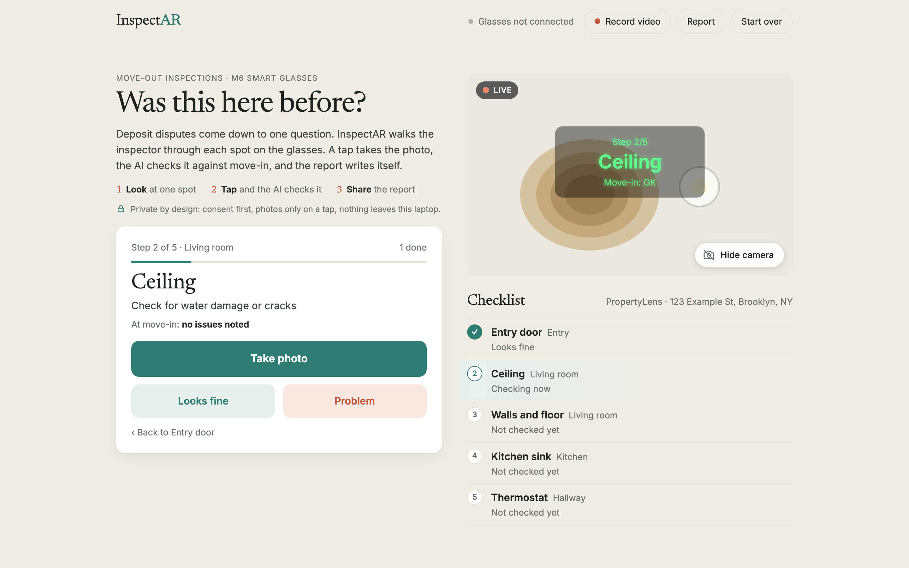
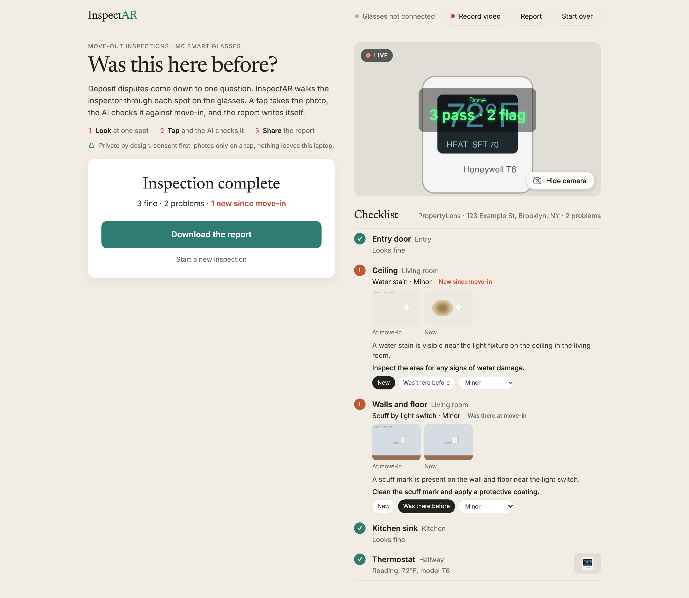
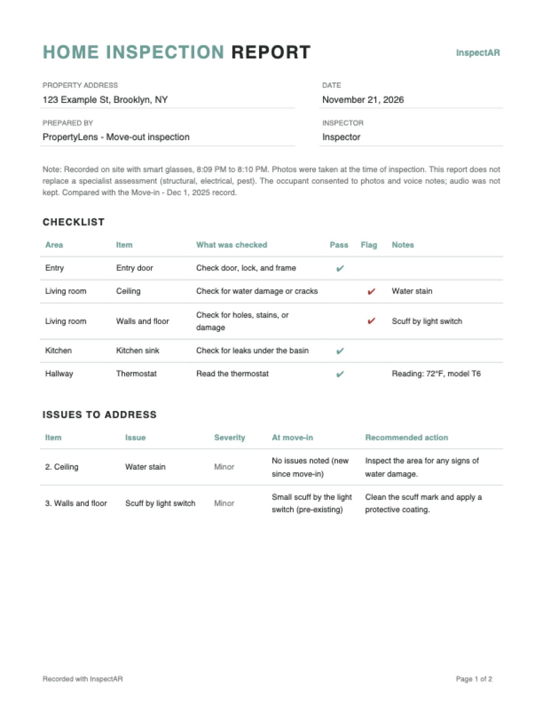
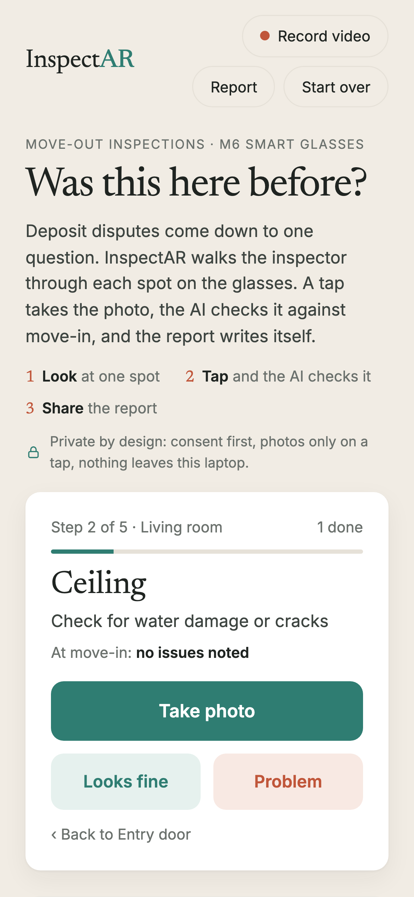

# InspectAR

**Hands-free inspections on smart glasses. Look at a spot, tap, and a local AI checks it, compares it with the last inspection, and writes the report.**

Built in 24 hours at the Worn smart glasses hackathon (Brooklyn, November 2026) for the MicroLumin M6 glasses. The demo checklist is **PropertyLens**, a rental move-out inspection that answers the question behind most deposit disputes: *was this here before?*



## What it does

1. **The glasses lead.** The M6 display shows one spot at a time (`Step 2/5 · Ceiling · Move-in: OK`), in a few words of green text you can read while you work.
2. **One tap does the work.** A tap on the temple touchpad takes a photo with the glasses' camera. A vision model running on the laptop looks at it and decides: looks fine, or here's the problem. The glasses confirm in a few seconds. Swipe forward to pass a spot, swipe back to redo one.
3. **Every problem is compared with move-in.** Each flag is marked *new since move-in* or *was there at move-in*, with the two photos side by side. That's the part landlords and tenants actually argue about.
4. **Gauges are read, not just photographed.** Steps like a thermostat, meter or label are read straight from the photo (`72°F, model T6`).
5. **The report writes itself.** A live web page on the laptop or phone shows the glasses' camera, the checklist and one-tap fixes, and exports a clean PDF.

| Finished inspection | PDF report | On a phone |
|---|---|---|
|  |  |  |

## Private by design

- The occupant's consent is required before an inspection starts, and it's printed on the report.
- The camera captures only on a tap. Live view is off unless you turn it on.
- **All AI runs locally** (Ollama + Qwen2.5-VL for vision, faster-whisper for speech). No photos or audio leave the laptop, and it costs nothing to run.

## Not just move-outs

Checklists are plain JSON files in [`templates/`](templates). The same engine runs:

- **PropertyLens · Move-out inspection** (the demo, with a move-in record in [`baselines/`](baselines))
- **Electrician · Panel inspection** (panel cover, scorch marks, labels, main breaker rating, GFCI)
- **Vehicle walkaround**
- **Workplace safety walk**

## How it works

```
 M6 glasses (Android 9)              Laptop                              Browser (laptop or phone)
 ┌───────────────────────┐   WS    ┌──────────────────────────────┐  WS  ┌──────────────────────────┐
 │ Kotlin app            │ ──────▶ │ FastAPI backend              │ ───▶ │ Live page: camera view,  │
 │ · shows the step      │  photo  │ · checklist state            │      │ checklist, fixes         │
 │ · tap = photo         │  frames │ · Qwen2.5-VL via Ollama      │      │ · PDF report             │
 │ · swipe = pass / back │ ◀────── │ · move-in comparison         │      └──────────────────────────┘
 └───────────────────────┘ result  │ · fpdf2 report               │
                                   └──────────────────────────────┘
```

- **Glasses app** ([`glasses-app/`](glasses-app)): Kotlin, plain Android APIs (Camera1, OkHttp WebSocket). Streams small JPEG frames for the live view and reuses the newest frame when you tap, so a capture feels instant.
- **Backend** ([`backend/`](backend)): FastAPI with WebSockets for the glasses, the phone and the report pages. One AI call per photo. The model describes what it sees, and simple rules (with negation handling: "no visible stains" is not a stain) decide pass or flag, which keeps the small local model reliable.
- **Web page** ([`backend/static/index.html`](backend/static/index.html)): a single HTML file, no framework.
- **Report** ([`backend/pdf.py`](backend/pdf.py)): a form-style PDF with a checklist table, an issues table with an "At move-in" column, and a photo grid.

## Run it

You need Python 3.11+ and, for the free local AI, [Ollama](https://ollama.com).

```bash
python3 -m venv .venv
.venv/bin/pip install -r requirements.txt
cp .env.example .env            # set AI_MODE=ollama for the local vision model
ollama pull qwen2.5vl:3b
.venv/bin/uvicorn backend.main:app --host 0.0.0.0 --port 8000
```

Open http://localhost:8000.

### Try it without glasses

```bash
.venv/bin/python scripts/demo_run.py      # plays a full move-out inspection with sample photos
.venv/bin/python scripts/mock_glasses.py  # a terminal "glasses": Enter = tap, prints what the display shows
```

### On the M6 glasses

Build the app (see [`glasses-app/README.md`](glasses-app/README.md)), plug the glasses in over USB, then:

```bash
scripts/restart_glasses.sh usb
```

This forwards port 8000 over the cable and opens the app. Without `usb`, it uses the laptop's Wi-Fi address instead.

### AI modes (`AI_MODE` in `.env`)

| Mode | Cost | Notes |
|---|---|---|
| `mock` | Free | Rule-based, offline. Can't see photos. |
| `ollama` | Free | Local vision model. What we demoed. |
| `anthropic` | Paid | Claude for notes and photos. Needs `ANTHROPIC_API_KEY`. |

If an AI call fails, the step is still saved, so an inspection never breaks.

## API

- `GET /api/templates`, `POST /api/inspections` `{template_id, property_address?, inspector?, consent}`
- `GET /api/inspections/current`, `POST /api/inspections/current/command` `{command: pass|flag|next|back|repeat|finish, note?}`
- `POST /api/capture` (multipart `photo`, `audio`, `note`)
- `POST /api/live` `{on}`, `POST /api/record/start`, `POST /api/record/stop`, `POST /api/reset`
- `WS /ws/glasses`, `WS /ws/phone`, `WS /ws/report`
- `GET /` live page, `GET /report.pdf` PDF report

## Team

Hardik Kafle and Ahmed Rasheed Yar Khan.

The MicroLumin SDK is not part of this repo. The glasses app uses only standard Android APIs.
